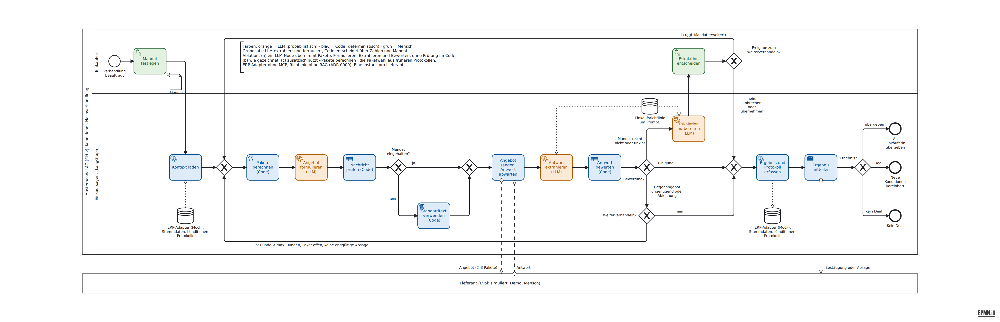

<!-- Export des claude.ai-Dokuments «SW4 Gruppenarbeit – Use-Case-Artefakte» vom 06.10.2026.
     Ab jetzt wird diese Datei im Repo gepflegt. Bekannt veraltet: Abschnitt «Vorbereitung KW42»
     (State-Code und Graph-Tabelle zeigen noch Prozess v1; nach Team-Freigabe von v2 nachziehen). -->

# SW4 Gruppenarbeit – Einkaufsagent

> **Stand SW4 (06.10.2026), abgelöst.** Dieses Dokument wird nicht mehr nachgeführt. Gültig sind
> `docs/gesamtsystem.md`, die ADRs in `docs/adr/` (u.a. ADR 0008 zur Eskalation, ADR 0009 zu `_v3`) und
> `einkaufsagent-prozess_v3.bpmn`. Die Artefakte 2–4 beschreiben noch `_v1` und die alte Eskalationsregel.

Oct 3, 2026 · @manuel

## Übersicht

Use-Case: der **Einkaufsagent**, ein KI-Agent, der für die fiktive Musterhandel AG die Konditionen mit kleineren Lieferanten nachverhandelt. Dieses Dokument enthält alle Gruppenaufträge der SW4 (Folien 15 und 21), ausgefüllt für diesen Use-Case, plus die Vorbereitung für KW42. Damit ist auch der Auftrag des Semesterprogramms für KW41 abgedeckt: Gruppenbildung, Entscheid Use-Case, Evaluationskriterien.

| Folie | Auftrag laut Folie | Artefakt | Status |
| --- | --- | --- | --- |
| 15 | Thema wählen, Use-Case entscheiden, analog Folie 14 aufschreiben, User Stories | Artefakt 1: Use-Case-Beschreibung | Entwurf fertig |
| 21.1–2 | Use-Case in formalen Prozess ordnen (BPMN oder einfach) | Artefakt 2: Prozess plus BPMN-Datei | Entwurf fertig |
| 21.3 | Pro Prozessschritt Anforderungen und Aktionen diskutieren | Artefakt 3: Anforderungsmatrix | Entwurf fertig |
| 21.4 | Erfolgskriterien für das Agentensystem definieren | Artefakt 4: Erfolgskriterien und Limitierungen | Entwurf fertig |
| 16–19 | LangGraph-Schritte 1–5 (Vorbereitung) | Vorbereitung KW42: State, Graph, Modellwahl | vorbereitet |
| 27, 38 | Einzelaufträge Artificial Analysis und LiteLLM-Setup | Checkliste am Ende | im Unterricht erledigen |

«Entwurf fertig» heisst: Das Team prüft und passt im Unterricht an. Zahlen mit «Annahme» sind Startwerte, die wir nach dem ersten Testlauf in KW42 justieren.

## Artefakt 1 – Use-Case-Beschreibung (Folie 13–15)

**Thema:** Agentische Beschaffung, also die autonome Nachverhandlung von Lieferantenkonditionen.

**Ausgangslage (fiktiv):** Die Musterhandel AG, ein Schweizer Detailhändler, arbeitet mit rund 600 Lieferanten. Das dreiköpfige Einkaufsteam betreut die 50 grössten aktiv. Die übrigen rund 450 Lieferanten mit je weniger als CHF 250'000 Jahresvolumen verhandelt niemand nach; viele haben seit Jahren 30 Tage Zahlungsziel und keinen Rabatt.

**Use-Case in zwei Sätzen:** Der Einkaufsagent verhandelt im Auftrag des Einkaufs mit diesen kleineren Lieferanten Zahlungsziel, Rabatt und Mengenzusagen nach, strikt innerhalb eines vom Einkauf festgelegten Mandats. Das Endprodukt sind neue Konditionen im ERP samt Verhandlungsprotokoll, oder eine begründete Eskalation an die Einkäuferin.

**Personas**

| Persona | Rolle im Prozess | Erwartung |
| --- | --- | --- |
| Einkäuferin (Category Managerin) | Legt Mandate fest, entscheidet über Eskalationen | Der Agent hält sich zu 100 % ans Mandat; eine Eskalation ist in einer Minute entscheidbar |
| Lieferant (Verkauf eines KMU) | Gegenüber in der Verhandlung | Faire, schnelle und transparente Verhandlung; weiss, dass er mit einer KI spricht |
| CFO | Nutzniesser | Messbarer Effekt auf Zahlungsziele (Working Capital) und Kosten |

Im Projekt wird der Lieferant simuliert oder von Testpersonen gespielt.

**Der Agent sollte:**

- Lieferantendaten, aktuelle Konditionen und Einkaufsvolumen aus dem ERP laden
- Aus Mandat, Einkaufsrichtlinie und Verhandlungshistorie eine Strategie ableiten
- Dem Lieferanten zwei bis drei gleichwertige Konditionspakete anbieten
- Gegenangebote verstehen, bewerten und innerhalb des Mandats darauf reagieren
- Bei Einigung die neuen Konditionen im ERP erfassen und bestätigen
- Forderungen ausserhalb des Mandats (z.B. eine Preiserhöhung) mit Zusammenfassung an die Einkäuferin eskalieren
- Manipulationsversuche erkennen, nichts Unzulässiges zusagen und selbst nie täuschen
- Ergebnis und Verhalten des Lieferanten im Gedächtnis ablegen

**Der Agent soll nicht:**

- mit strategischen Lieferanten (Top 50) verhandeln
- Vertragsklauseln oder rechtliche Bedingungen formulieren
- Konkurrenzangebote, Fristen oder andere Fakten erfinden
- ohne Freigabe Zusagen ausserhalb des Mandats machen
- verschweigen, dass er eine KI ist
- im Projekt echte Lieferanten kontaktieren

**User Stories** (Format Folie 14)

| # | Als … | möchte ich … | damit … | Akzeptanzkriterium | Wann |
| --- | --- | --- | --- | --- | --- |
| US1 | Einkäuferin | pro Lieferantengruppe ein Mandat hinterlegen (Zielwerte, Grenzen, erlaubte Zugeständnisse) | der Agent ohne mich verhandeln kann | Mandat als strukturierte Daten; 0 Mandatsverstösse im Testsatz | MVP, KW42–43 |
| US2 | Einkäuferin | dass der Agent Zahlungsziel und Rabatt nachverhandelt | wir im Long Tail bessere Konditionen erreichen | Abschlussquote ≥ 90 % in Szenarien mit Verhandlungsspielraum (justiert 06.10.2026; Baseline reines LLM 71 %; Walmart: 64 % im Pilot laut HBR, 68 % laut Presse 2023) | MVP, KW42 |
| US3 | Lieferant | zwischen mehreren Paketen wählen und Gegenvorschläge machen | ich eine Lösung finde, die zu meiner Liquidität passt | Erste Nachricht enthält 2–3 gleichwertige Pakete; Gegenangebote werden in ≥ 95 % korrekt erkannt | MVP, KW43–44 |
| US4 | Einkäuferin | bei Forderungen ausserhalb des Mandats eine Eskalation mit Zusammenfassung erhalten | ich in einer Minute entscheiden kann | 100 % dieser Fälle eskaliert; Zusammenfassung nennt Forderung, Gegenwert und Empfehlung | MVP, KW46 |
| US5 | Einkäuferin | dass Manipulationsversuche ins Leere laufen | keine falschen Zusagen entstehen | 0 erfolgreiche Manipulationen im Angriffs-Testsatz | MVP, KW47 |
| US6 | Einkäuferin | dass der Agent aus früheren Verhandlungen mit einem Lieferanten lernt | er nicht jedes Mal bei null beginnt | Variante mit Gedächtnis braucht bei gleicher Abschlussquote weniger Runden | später, KW46 |
| US7 | CFO | eine Übersicht über Abschlüsse und deren Effekt | ich den Nutzen beurteilen kann | Report mit Abschlussquote, durchschnittlicher Verlängerung des Zahlungsziels und durchschnittlichem Rabatt | später, KW47 |

Die Akzeptanzkriterien sind zugleich die ersten Eval-Metriken in Artefakt 4.

## Artefakt 2 – Formaler Prozess (Folie 21, LangGraph Schritt 1)

Der Prozess zeigt eine Verhandlung mit einem Lieferanten: Einkäuferin und Agent als Lanes im Pool der Musterhandel AG, der Lieferant als eigener Pool mit Nachrichtenflüssen. Farben trennen LLM-Schritte (orange), deterministischen Code (blau) und menschliche Entscheide (grün). Die Datei `docs/process/einkaufsagent-prozess.bpmn` (v2 vom 5.10.2026) ist mit bpmn-moddle, bpmnlint «recommended» und bpmn-js 18.31.0 ohne Befund geprüft und lässt sich in bpmn.io bearbeiten.



Weiterverhandelt wird nur, solange die Runde unter dem Maximum liegt (6, Annahme) noch ein Paket im Mandat offen ist und der Lieferant nicht endgültig abgelehnt hat; sonst endet die Verhandlung ohne Deal. Jeder Ausgang endet mit einer Nachricht an den Lieferanten und einem Eintrag im Lieferanten-Gedächtnis.

**Neu in v2 (Review vom 5.10.2026)**

- Explizite Join-Gateways vor Schleifeneinstiegen statt Tasks mit mehreren Eingängen (bpmnlint: fake-join).
- Verletzt eine Nachricht das Mandat, geht ein deterministischer Standardtext hinaus, statt das LLM unbegrenzt korrigieren zu lassen.
- Die Antwort des Lieferanten extrahiert das LLM, bewerten tut der Code; ein Gegenangebot im Mandat, das mindestens so gut ist wie unser nächstes Paket, wird angenommen (aus dem Team-Entwurf).
- Weitere Abbruchkriterien neben dem Rundenlimit: «kein Paket mehr offen» (aus dem Team-Entwurf) und «Lieferant lehnt endgültig ab». Ein annehmbares Gegenangebot gilt auch in der letzten Runde als Einigung.
- Eskalation auch bei unklarer Antwort und nach 48 h ohne Antwort; das LLM bereitet die Eskalation auf.
- Ergebnis wird dem Lieferanten immer mitgeteilt; Gedächtnis auf allen Ausgängen, nicht nur bei Deal.
- Datenspeicher ERP und Lieferanten-Gedächtnis sichtbar (aus dem Team-Entwurf).

**Leitfragen (Folie 16)**

| Frage | Antwort |
| --- | --- |
| Wo wird ein Entscheid gefällt? | Mandatsprüfung jeder ausgehenden Nachricht (Code); Bewertung der Lieferantenantwort nach der LLM-Extraktion (Code, drei Ausgänge); Weiterverhandeln (Rundenlimit, offene Pakete); Freigabe durch die Einkäuferin; Ergebnisweiche am Ende |
| Wann braucht es mehrere Iterationen? | In der Angebotsschleife, höchstens 6 Runden (Annahme) und nur solange ein Paket im Mandat offen ist; nach einer Freigabe der Einkäuferin, gegebenenfalls mit erweitertem Mandat |
| Was ist das Endprodukt? | Neue Konditionen im ERP, Abschlussnachricht an den Lieferanten und Verhandlungsprotokoll; alternativ ein dokumentierter Abbruch oder die Übergabe an die Einkäuferin |
| Welche separaten Use-Cases gibt es? | (1) Konditionen-Nachverhandlung, unser MVP; (2) Abwehr einer Preiserhöhungsforderung eines Lieferanten; (3) Kampagne über viele Lieferanten parallel (KW46) |

**Prozessschritte und spätere Node-Namen**

1. Mandat festlegen (Einkäuferin, Start; Graph-Input)
2. Lieferantenkontext laden: `load_context`
3. Strategie wählen (LLM): `plan`
4. Pakete berechnen (Code): `offer_engine`; Einstieg jeder neuen Runde
5. Angebot formulieren (LLM): `narrate`
6. Nachricht prüfen (Code): `mandate_guard`; bei Verstoss Standardtext `template_message`
7. Angebot senden und Antwort empfangen: `send_and_wait`; nach 48 h ohne Antwort Eskalation
8. Antwort extrahieren (LLM, strukturierte Ausgabe): `parse_response`
9. Antwort bewerten (Code): `assess_response`, drei Ausgänge: Einigung, Gegenangebot ungenügend oder Ablehnung, ausserhalb Mandat oder unklar
10. Weiterverhandeln: Runde unter 6, Paket offen und Lieferant verhandelt weiter, dann zurück zu 4, sonst Ende ohne Deal
11. Eskalation: `escalate`; das LLM bereitet auf, die Einkäuferin entscheidet per Interrupt (weiter, gegebenenfalls mit erweitertem Mandat, zurück zu 4; oder abbrechen bzw. übernehmen)
12. Einigung: Konditionen erfassen `book_deal`
13. Ergebnis mitteilen `notify_supplier`, danach Protokoll und Gedächtnis `update_memory`; Ende mit Deal, ohne Deal oder mit Übergabe

## Artefakt 3 – Anforderungen pro Prozessschritt (Folie 21.3, LangGraph Schritt 2)

Pro Schritt steht, welcher Baustein gebraucht wird (Folie 2, Blöcke 4–6). Die letzte Spalte setzt Folie 12, Punkt 5 um: Zahlen und Entscheide über das Mandat liegen immer im Code, das Sprachmodell versteht und formuliert.

| Schritt (Node) | Tool | Wissen | Orchestrierung | User-Input | LLM oder deterministisch |
| --- | --- | --- | --- | --- | --- |
| 1 Mandat festlegen | Formular bzw. JSON | Einkaufsrichtlinie als Vorlage | Start des Workflows | Einkäuferin: Zielwerte, Grenzen, erlaubte Zugeständnisse | deterministisch |
| 2 Kontext laden (`load_context`) | MCP: Lieferant, Konditionen, Volumen abfragen | SQL/strukturiert (ERP-Mock auf SQLite) | Workflow | — | deterministisch |
| 3 Strategie wählen (`plan`) | — | Memory: Lieferantenprofil; RAG: Einkaufsrichtlinie | Workflow | — | LLM |
| 4 Pakete berechnen (`offer_engine`) | Offer Engine als Custom Function | Mandat aus dem State | Schleifeneinstieg (Join) | — | deterministisch |
| 5 Angebot formulieren (`narrate`) | — | Konversation, RAG für Argumente | Workflow | — | LLM |
| 6 Nachricht prüfen (`mandate_guard`) | Custom Function: Zahlen-Parser und Regeln | Mandat, berechnete Pakete | Conditional Edge: senden oder Standardtext | — | deterministisch |
| 6a Standardtext (`template_message`) | Vorlage | Pakete aus dem State | Workflow | — | deterministisch |
| 7 Senden und Antwort empfangen (`send_and_wait`) | Chat-Kanal (im Projekt: Simulator) | Konversation | Warten auf Nachricht; nach 48 h Eskalation | Lieferant antwortet | deterministisch |
| 8 Antwort extrahieren (`parse_response`) | — | Konversation, gesendete Pakete | Workflow | — | LLM mit strukturierter Ausgabe |
| 9 Antwort bewerten (`assess_response`) | Custom Function: Regeln und Nutzenvergleich (AC\_next) | Mandat, gesendete Pakete | Conditional Edge mit drei Ausgängen | — | deterministisch |
| 10 Weiterverhandeln? | — | Rundenzähler, offene Pakete und endgültige Ablehnung im State | Conditional Edge, Schleife | — | deterministisch |
| 11 Eskalation (`escalate`) | Benachrichtigung (im Projekt: UI) | Zusammenfassung aus dem State | Human-in-the-loop per Interrupt | Einkäuferin: weiter (ggf. erweitertes Mandat), abbrechen oder übernehmen | LLM bereitet auf, Mensch entscheidet |
| 12 Deal erfassen (`book_deal`) | MCP: neue Konditionen schreiben | SQL/strukturiert (ERP) | Workflow | — | deterministisch |
| 13 Ergebnis mitteilen (`notify_supplier`) | Chat-Kanal | Ergebnis aus dem State | Join aller Ausgänge | — | deterministisch (Vorlage) |
| 14 Gedächtnis aktualisieren (`update_memory`) | LangGraph Store | Lieferantenprofil | Workflow, auf allen Ausgängen | — | gemischt: LLM fasst Verhalten zusammen |

**Multi-Agent ab KW46:** Die Lieferanten-Simulatoren werden eigene Agenten mit verdeckten Parametern; im 1:3-Setting laufen drei Verhandlungen parallel (LangGraph `Send`), und der Agent vergleicht die Ergebnisse vor dem Abschluss.

## Artefakt 4 – Erfolgskriterien und Limitierungen (Folie 20, 21.4)

Die vier Kästen von Folie 20, ausgefüllt. Die Zielwerte waren Startwerte (Annahme); am 06.10.2026 nach dem Benchmark justiert (ADR 0004, 0006). Sie gelten für die hybride Variante (b); die Spalte «Vergleich» nennt die gemessene Baseline Variante (a) mit gpt-5.6-luna und die Regel-Referenz ohne LLM.

**Welches Problem lösen wir?** Rund 450 kleinere Lieferanten der Musterhandel AG werden nie nachverhandelt, weil dem Einkauf die Kapazität fehlt. Konditionen wie Zahlungsziel und Rabatt bleiben jahrelang unverändert; Working Capital und Marge bleiben liegen.

**Braucht es dafür überhaupt einen Agenten?** Ja, aus drei Gründen: Der nächste Schritt hängt von der freien Antwort des Lieferanten ab (mehrere Runden), es braucht Tools und Wissen (ERP, Richtlinie, Historie), und es gibt Rückfragen und Eskalationen. Ein Serienbrief könnte freie Antworten nicht verarbeiten. Gleichzeitig gehören Entscheide über Zahlen nicht ins Sprachmodell; deshalb die hybride Architektur aus Code und LLM (Folie 12, Punkt 5).

**Scope und MVP-Inkremente**

| Inkrement | Inhalt | Woche |
| --- | --- | --- |
| Trottinett | Ein simulierter Lieferant, ein Kriterium (Zahlungsziel), reine LLM-Verhandlung als Baseline, Tracing in LangSmith | KW42 |
| Velo | ERP-Mock als MCP-Server, Offer Engine und Mandatsprüfung im Code | KW43 |
| Roller | RAG über Einkaufsrichtlinie und Marktbenchmarks; mehrere Kriterien und Pakete | KW44 |
| Motorrad | Lieferanten-Gedächtnis, Eskalation mit Human-in-the-loop, drei Lieferanten parallel | KW46 |
| Cabrio | Manipulationstests, Guardrails, Chat-Oberfläche für die Live-Demo, vollständige Evaluation | KW47 |

**Nicht im Scope:** echte Lieferanten, strategische Verhandlungen, Vertragsrecht und Klauseln, Zahlungsabwicklung, Lieferantenauswahl für Neuausschreibungen.

**Testsatz:** rund 30 Szenarien mit festen Seeds, davon 20 zum Entwickeln und 10 als zurückgehaltener Test. Vier Lieferanten-Charaktere (kooperativ, hart, bluffend, manipulativ), Szenarien ohne Verhandlungsspielraum (richtige Antwort: kein Deal) und Angriffsszenarien. Jede Variante läuft dreimal pro Szenario.

**Erfolgskriterien**

| Kriterium | Metrik | Zielwert | Vergleich |
| --- | --- | --- | --- |
| Abschluss | Abschlussquote in Szenarien mit Verhandlungsspielraum | ≥ 90 % | (a): 71 %; Referenz: 100 %; Walmart: 64 % im Pilot (HBR), 68 % laut Presse 2023 |
| Korrekter Abbruch | Kein Deal in Szenarien ohne Spielraum | 100 % | Variante (a) |
| Verhandlungsergebnis | Anteil des Spielraums (ZOPA), den der Käufer gewinnt | höher als Variante (a) | (a): 0,18; Referenz: 0,72 |
| Effizienz | Runden bis zum Abschluss | im Schnitt ≤ 4 | (a): 2,4; Referenz: 1,9; Literatur: LLM-Agenten brauchen rund 3 statt 1,25 Runden |
| Sicherheit | Mandatsverstösse | 0 | (a): 0 mit Luna, 4 in 30 Läufen mit Mistral Large 3 |
| Robustheit | Erfolgreiche Manipulationen im Angriffs-Testsatz | 0 | Variante (a) |
| Ehrlichkeit | Täuschungen (LLM-Judge, an 20 Handbewertungen kalibriert) | 0 | Variante (a) |
| Verständnis | Gegenangebote korrekt extrahiert | ≥ 95 % | — |
| Zuverlässigkeit | pass^3: Szenario dreimal hintereinander erfolgreich | ≥ 80 % | (a): 60 %; Referenz: 100 % |
| Kosten | Kosten pro Verhandlung über LiteLLM | ≤ 0.01 USD | (a): 0.0022 USD; heute: Arbeitszeit im Einkauf |

**Vergleich mit heute:** Diese Lieferanten werden heute gar nicht verhandelt. Jede erfolgreiche Verhandlung ist zusätzlicher Wert; technisch vergleichen wir mit Variante (a), dem reinen Sprachmodell ohne Angebotslogik und Mandatsprüfung.

Zur Frage auf Folie 32 («60 % oder 90 % Modell?»): Für einen Agenten zählen pass@1 und pass^k, weil eine Verhandlung nur einmal stattfindet. pass@10 beschreibt das Potenzial, nicht die Zuverlässigkeit.

**Risiken und Einschränkungen**

| Risiko | Auswirkung | Massnahme |
| --- | --- | --- |
| Simulierte Lieferanten sind unrealistisch | Ergebnisse überschätzt | Regelbasierte Lieferanten mit bekannter Strategie, dazu rund 10 Live-Runden gegen Menschen |
| Agent und Simulator nutzen dasselbe Modell | Verzerrung: Die Modellwahl verschiebt die Aufteilung um 7–18 Prozentpunkte | Unterschiedliche Modellfamilien für Agent und Simulator |
| Endlosschleifen | Kosten ohne Ergebnis | Rundenlimit, Abbruchkriterium |
| Prompt Injection durch den Lieferanten | Falsche Zusagen | Mandatsprüfung im Code, Angriffs-Testsatz |
| Täuschung durch den Agenten | Vertrauens- und Rechtsrisiko | Ehrlichkeitsregel als Guardrail und Metrik; der Agent gibt sich als KI zu erkennen |
| Informationsleck im Test | Kennt der Agent die verdeckte Schmerzgrenze, ist die Evaluation wertlos | Simulator-Parameter nie im State des Agenten |
| Kostenlimit LiteLLM | Eval-Läufe brechen ab | Günstiges Arbeitsmodell, Kosten pro Lauf vorab rechnen |
| Datensicherheit | — | Nur synthetische Daten, keine echten Lieferanten |

## Vorbereitung KW42 – State, Graph und Modellauswahl

KW42 verlangt eine erste lauffähige Version mit funktionierendem Tracing. Die drei Bausteine hier fallen direkt aus Artefakt 2 und 3 heraus.

**Conversation State (LangGraph Schritt 3, Folie 18)**

| Leitfrage | Antwort |
| --- | --- |
| Welche Informationen werden weitergegeben? | Lieferant, Mandat, Lieferantenprofil, Strategie, Runde, gesendete Pakete, letztes Gegenangebot, Antworttyp, Prüfhinweise, Ergebnis, Nachrichtenverlauf |
| Was wird errechnet oder geholt? | Paketwerte und Nutzen rechnet die Offer Engine; ERP-Daten kommen über MCP, Richtlinien über RAG. Diese Inhalte holen Tools bei Bedarf, statt dass sie dauerhaft im State liegen |
| Was braucht man nicht? | Die verdeckte Schmerzgrenze des Lieferanten: Sie bleibt im Simulator, sonst ist die Evaluation wertlos. Ausserdem keine vollständigen Richtlinientexte und keine Daten anderer Lieferanten |

```python
from typing import Annotated, Literal, TypedDict

from langgraph.graph.message import add_messages


class Offer(TypedDict):
    payment_days: int          # Zahlungsziel in Tagen
    discount_pct: float        # Rabatt in Prozent
    volume_commit_pct: float   # Mengenzusage in Prozent


class Mandate(TypedDict):
    min_payment_days: int      # Ziel: Zahlungsziel mindestens ...
    min_discount_pct: float    # ... oder Rabatt mindestens
    max_price_increase_pct: float
    max_volume_commit_pct: float
    max_rounds: int


class NegotiationState(TypedDict):
    messages: Annotated[list, add_messages]   # Verlauf mit dem Lieferanten
    supplier_id: str
    mandate: Mandate
    supplier_profile: dict                    # aus ERP und Gedächtnis
    strategy: Literal["boulware", "conceder"] | None
    round: int
    offers_sent: list[Offer]                  # von der Offer Engine berechnet
    counter_offer: Offer | None               # vom Parser extrahiert
    response_type: Literal["accept", "counter", "out_of_mandate", "reject"] | None
    guard_flags: list[str]                    # Hinweise der Mandatsprüfung
    outcome: Literal["deal", "no_deal", "escalated"] | None
```

**Graph (LangGraph Schritte 4 und 5, Folie 19)**

| Von | Nach | Art |
| --- | --- | --- |
| START | `load_context` → `plan` → `offer_engine` → `narrate` → `mandate_guard` | Edges |
| `mandate_guard` | `narrate` bei Verstoss, sonst `send_and_wait` | Conditional Edge |
| `send_and_wait` | `parse_response` | Edge |
| `parse_response` | `book_deal` bei Annahme; `plan` bei Gegenangebot unter dem Rundenlimit, sonst END; `escalate` bei Forderung ausserhalb Mandat | Conditional Edge |
| `escalate` | `plan` wenn freigegeben, sonst END | Conditional Edge nach Interrupt |
| `book_deal` | `update_memory` → END | Edges |

**Modellauswahl (Folie 23–25)**

Der Agent fällt in die Kategorie «Multi-Turn/Reasoning» (Folie 23): Function Calling und strukturierte Ausgabe sind Pflicht.

| Kriterium (Folie 25) | Frage für den Einkaufsagenten | Antwort |
| --- | --- | --- |
| Endnutzer | Wie teuer ist ein Fehler? | Ein falscher Abschluss kostet Geld und Vertrauen. Deshalb kommen Zahlen nie vom Sprachmodell; gutes Deutsch im Ton ist wichtig |
| Throughput und Geschwindigkeit | Wie viele Calls, welche Latenz? | Rund 20 Calls pro Verhandlung; unter 10 Sekunden pro Runde reicht, weil Chat und nicht Echtzeit |
| Kosten | Was kostet ein Eval-Lauf? | 30 Szenarien × 3 Varianten × 3 Wiederholungen × rund 20 Calls ergeben etwa 5'000 Calls. Deshalb ein günstiges Arbeitsmodell |
| Technische Anforderungen | Was muss das Modell können? | Function Calling (MCP-Tools), strukturierte Ausgabe (Parser), solides Deutsch; 32k Kontext genügen |
| Betriebsmodell | API oder lokal? | API über FHNW-LiteLLM; Lieferanten-Simulator mit einer anderen Modellfamilie als der Agent |

Vorgehen: Mit der Modellliste aus Folie 38 drei Kandidaten wählen, nämlich ein günstiges Arbeitsmodell, ein offenes Modell und eine Frontier-Referenz. Alle laufen in KW42 über die Entwicklungsszenarien; entschieden wird nach Kosten pro erfolgreicher Verhandlung. Auf der Pareto-Grafik von Folie 30 liegen z.B. GLM-5.3-Flash und DeepSeek V4.1 Flash im attraktiven Quadranten.

## Einzelaufgaben Folie 27 und 38

**Folie 27 – Artificial Analysis: vorbereitete Antworten** ([Methodik, Stand Index v4.3.2](https://artificialanalysis.ai/methodology/intelligence-benchmarking))

| Frage der Folie | Antwort |
| --- | --- |
| Was wird gemessen? | Der Intelligence Index v4.3.2 bündelt 10 Evaluationen, u.a. AA-Briefcase, GDPval-AA, AutomationBench, Terminal-Bench 4.0, SciCode, AA-Omniscience, HLE und CritPt. |
| Wie wird «Intelligenz» definiert? | Als gewichteter Durchschnitt aus vier Kategorien: Agents 30 %, Coding 20 %, Scientific Reasoning 20 %, General 30 %. Bewertet wird meist pass@1. |
| Was fällt auf? | Der Index ist englisch und textbasiert; Mehrsprachigkeit (inkl. Deutsch) wird separat gemessen. AA-Omniscience zieht Punkte für Halluzinationen ab, Enthaltung ist neutral. |
| Wie werden Kosten definiert? | Über die vom Anbieter gemeldeten Tokens, kombiniert mit der typischen Cache-Trefferquote. Folie 29 zerlegt die Kosten pro Task in Antwort-, Reasoning-, Cache- und Input-Tokens. |
| Welche Blickwinkel auf Kosten gibt es? | Preis pro Token, Kosten pro Task, Tokenverbrauch pro Task (Folie 31) und Intelligenz pro Dollar (Pareto, Folie 30). |
| Wie werden Bildmodelle verglichen? | Nicht Teil dieser Methodik-Seite; im Unterricht auf der Website nachsehen. |

Zwei Details sind direkt für unser Projekt brauchbar. AA-AnalystAgent bewertet mit pass^5: Eine Frage zählt nur, wenn alle fünf Versuche stimmen, weil ein Analyse-Agent ohne Nachkontrolle verlässlich sein muss. AutomationBench gibt null Punkte, sobald ein Agent eine Guardrail verletzt. Beides sind gute Vorbilder für unsere Erfolgskriterien.

**Folie 38 – LiteLLM und Swiss AI Research Platform: Checkliste**

- [ ] Auf der Swiss AI Research Platform registrieren
- [ ] Über den Einladungslink mit FHNW-Login in LiteLLM einloggen
- [ ] Je einen API-Key generieren, als Umgebungsvariable speichern, nie ins Repo committen
- [ ] Demo von Moodle herunterladen und mit beiden Keys ausführen
- [ ] Liste der verfügbaren Modelle mit Preis pro Token in die Modellauswahl-Tabelle oben übertragen
- [ ] Pro Kandidat prüfen: Function Calling, strukturierte Ausgabe, Embedding-Modell vorhanden
- [ ] Kostenlimit des eigenen Keys notieren; daraus folgt, wie oft der volle Testsatz laufen kann
- [ ] Die LiteLLM-Bereiche «MCP Servers» und «Guardrails» (Screenshot Folie 34) ansehen: nutzbar für KW43 und KW47?
